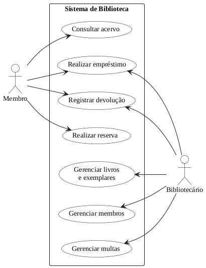

# 2. Casos de Uso

## 2.1 Diagrama

## 2.2 UC01 — Realizar empréstimo

**Atores:** Membro e Bibliotecário  
**Pré-condição:** o membro tem cadastro válido.

**Fluxo principal**

1. O membro pede o empréstimo de um livro.
2. O bibliotecário informa a matrícula do membro e o código do exemplar.
3. O sistema verifica se o membro tem menos de 3 empréstimos ativos.
4. O sistema verifica se o exemplar está disponível e em bom estado.
5. O sistema registra o empréstimo com a data de hoje e prazo de 14 dias.
6. O sistema mostra a data de devolução.

**Fluxos alternativos**

- **3a.** O membro já tem 3 empréstimos ativos: o sistema mostra uma mensagem e não faz o empréstimo.
- **4a.** O exemplar está emprestado ou danificado: o sistema avisa que o exemplar não pode ser emprestado.

## 2.3 UC02 — Registrar devolução

**Atores:** Membro e Bibliotecário  
**Pré-condição:** existe um empréstimo ativo para o exemplar.

**Fluxo principal**

1. O membro entrega o exemplar.
2. O bibliotecário informa o código do exemplar.
3. O sistema encontra o empréstimo ativo.
4. O sistema registra a data de devolução e encerra o empréstimo.
5. O exemplar volta a ficar disponível.

**Fluxos alternativos**

- **4a.** A devolução foi depois do prazo: o sistema calcula os dias de atraso, gera a multa e vincula ao membro.
- **3a.** Não existe empréstimo ativo para esse exemplar: o sistema mostra uma mensagem de erro.

## 2.4 UC03 — Realizar reserva

**Ator:** Membro  
**Pré-condição:** o membro tem cadastro válido.

**Fluxo principal**

1. O membro pesquisa um livro.
2. O membro escolhe a opção de reservar.
3. O sistema verifica se o livro tem exemplares emprestados.
4. O sistema registra a reserva para o livro, com a data de hoje.

**Fluxo alternativo**

- **3a.** Todos os exemplares estão disponíveis: o sistema não deixa reservar e avisa que o membro pode fazer o empréstimo direto.
